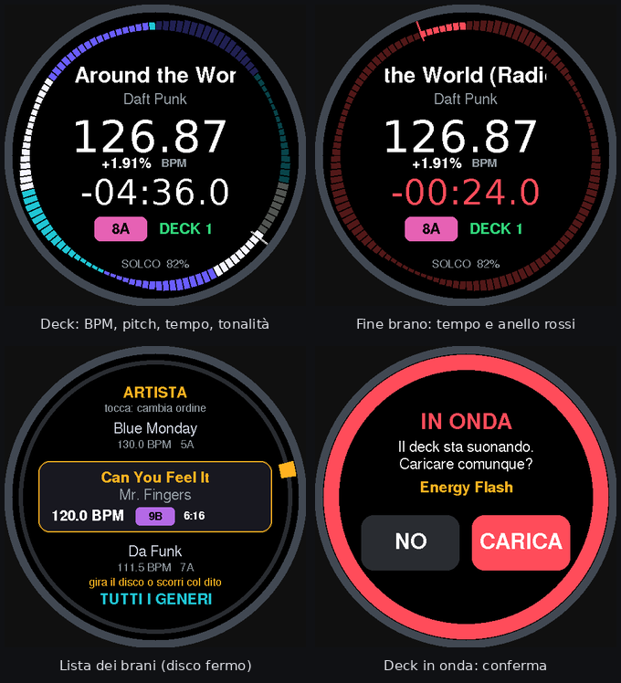

# SOLCO — lettore per DJ su tablet

Un tablet Android diventa un lettore da collegare al mixer: forma d'onda, BPM e tonalità rilevati in automatico, cue, hot cue, loop, key lock, slip, reverse e scratch con la jog sullo schermo o con una jog fisica.

## Installare l'app sul tablet

1. Dal tablet apri la pagina **Releases** di questo repository e scarica `solco.apk` dall'ultima versione.
2. Apri il file scaricato. La prima volta Android chiede di permettere l'installazione da Chrome (o dall'app File): conferma.
3. Avvia **SOLCO**, tocca **BRANI** → **+ IMPORTA** e scegli i brani salvati sul tablet (MP3, AIFF, WAV, FLAC, M4A). Vengono copiati nell'app e analizzati una volta sola.

Per aggiornare basta installare il nuovo `solco.apk` sopra quello vecchio: libreria, cue e impostazioni restano.

**Musica su Google Drive**: in + IMPORTA il selettore di Android mostra anche Drive. Tieni premuto un brano per selezionarne più di uno (nel menu del selettore di solito c'è anche «Seleziona tutto»): SOLCO li scarica e ne tiene una copia sua, così durante il set non serve internet. Reimportando la stessa cartella, i brani già presenti vengono saltati. Su Windows, con l'app Google Drive per desktop, Drive compare come un disco in Esplora file.

## Lista dei brani

- **Ordine**: RECENTI, TITOLO, ARTISTA, BPM oppure **CAMELOT** (1A, 1B, 2A… e, a pari chiave, per BPM).
- **GENERE**: mostra solo i brani di un genere, preso dai tag del file. FLAC, AIFF, MP3 e M4A possono averlo; i WAV di solito no. Dentro il genere puoi ordinare per BPM o CAMELOT.
- **COMPATIBILI**: solo i brani entro il 6% di BPM da quello caricato e in chiave compatibile (stesso numero, oppure numero accanto con la stessa lettera).

## Smartphone

Sugli schermi piccoli SOLCO usa da solo la disposizione **smartphone**: niente jog e fader a schermo (si suona col giradischi e il puck, o con un controller), SLIP e KEY LOCK passano nella fila dei tasti in basso, tutto il resto più grande. Il BPM si può comunque scrivere toccando il BPM. *Impostazioni → Schermo → Disposizione*: AUTO, TABLET o SMARTPHONE.

## Comandi a schermo

Senza la jog fisica collegata l'app mostra tutti i comandi sullo schermo. In **verticale** (di serie) la disposizione è quella di un lettore da club: schermo sopra, hot cue e loop, jog al centro, fader del tempo a destra, CUE e PLAY in basso a sinistra.

- **Jog**: il bordo accelera o frena il brano in onda (in pausa sposta il punto e lo fa sentire). In modo **VINILE**, toccando il centro fermi il brano sotto il dito e girando fai scratch; un giro vale 1,8 s di brano, come un 33 giri. I tasti ◀ ▶ accanto alla jog spingono a velocità costante.
- **Fader del tempo**: si sposta solo trascinandolo, mai di colpo nel punto toccato (− in alto, + in basso). **TEMPO 0** va tenuto premuto. Cambiando il range (±6…50%) il tempo resta lo stesso.
- **BPM preciso**: tocca il BPM in alto (o la percentuale sotto il fader) e scrivi il BPM che vuoi, anche con la virgola: il tempo si imposta esatto. Se il valore sta fuori dal range, il range si allarga da solo quanto basta.
- **Orientamento**: bloccato, così il tablet non gira da solo durante la serata. Si cambia da *Impostazioni → Schermo → Orientamento* (verticale, orizzontale o automatico).

## Versione per Windows (Galaxy Book e altri PC touch)

La stessa app gira anche su Windows, in una finestra a schermo intero: comoda su un portatile touch come il Galaxy Book 360, meglio se piegato a tablet e appoggiato sul tavolo.

- **Installazione**: dalla pagina *Releases* scarica **SOLCO-Setup.exe** e aprilo. Se compare «Windows ha protetto il PC», tocca «Ulteriori informazioni» e poi «Esegui comunque». Si crea l'icona SOLCO sul desktop.
- **Schermo intero**: parte già a schermo intero; F11 o il tasto ⛶ in alto lo attivano e disattivano.
- **Audio**: esce dall'uscita predefinita di Windows (jack delle cuffie o scheda audio USB).
- **Brani e jog fisica**: si importano come sul tablet; la jog SOLCO via USB viene riconosciuta da sola.

## Collegamenti

- **Solo comandi a schermo**: basta un cavo **USB-C → RCA con DAC integrato** (i tablet Samsung recenti non hanno il jack e con un cavo senza DAC non esce suono). Il cavo occupa l'unica presa del tablet, quindi durante il set non si ricarica.
- **Con la jog fisica**: **hub USB-C** nel tablet, e nell'hub: la jog SOLCO, una scheda audio USB (es. Behringer UCA222) e il caricatore.
- **Audio:** uscita RCA della scheda audio → ingresso CD/LINE di un canale del mixer.
- **Jog e comandi fisici:** l'app riconosce da sola la jog SOLCO; altri controller MIDI si assegnano da *Impostazioni → Comandi* (ASSEGNA, poi muovi il comando). I fader del tempo a 14 bit su due CC vengono riconosciuti da soli. Se la jog del controller manda il bordo su un CC a parte, assegna anche «Jog (bordo)». Con un controller che ha solo jog e fader, metti *Impostazioni → Schermo → Comandi a schermo* su **SEMPRE** per tenere CUE, PLAY e gli altri tasti sullo schermo.

## Giradischi come controller (puck Bluetooth)

Un **M5StickS3** sopra il disco misura quanto gira il disco e lo manda al tablet via Bluetooth MIDI: il brano segue il disco. Il pitch del giradischi regola il tempo; se fermi il disco il brano si ferma; lo scratch è vero scratch. Niente puntina, niente dischi timecode, nessun cavo verso il tablet. **Non ancora provato con l'hardware vero.** Con lo schermo per BPM, tempo e lista dei brani: vedi «Puck con schermo» più sotto.

**Serve, per ogni giradischi:** 1 M5StickS3 (M5Stack K150), il porta-puck stampato (`hardware/stampa/porta_puck.stl`, PLA, senza supporti), biadesivo forte, un disco vecchio qualsiasi (resta sempre quello: è il disco di controllo).

1. **Programma sul puck** (una volta, dal Galaxy Book): scarica `solco-puck.bin` dall'ultima versione su GitHub, apri https://espressif.github.io/esptool-js/ in Chrome o Edge, collega lo stick col cavo USB-C, premi *Connect* e scegli la porta, metti indirizzo `0x0` e il file `solco-puck.bin`, premi *Program*. Al riavvio lo schermo mostra «SOLCO Puck» e quattro cifre.
2. **Montaggio:** incolla il porta-puck sull'etichetta del disco. Il foro centrale è più largo del perno apposta: il puck deve girare col **disco**, non col piatto, altrimenti non sente il disco tenuto fermo né lo scratch. Infila lo stick, schermo in su; disco sullo slipmat.
3. **Collegamento:** SOLCO sul tablet → *Impostazioni → Comandi → CERCA PUCK* → tocca il puck. Poi si ricollega da solo.
4. **Calibrazione** (una volta): giradischi a 33 giri, pitch a 0, piatto in moto; tieni premuto il tasto **A** dello stick per 2 secondi e non toccare niente per circa 8 secondi, finché lo schermo dice «Calibrato a 33 giri» (se non sai qual è il tasto A: è quello che, tenuto premuto, fa comparire «Calibro»). Il tasto **B** azzera il giroscopio a piatto fermo; lo fa anche da solo ogni volta che il piatto è fermo.
5. **Prova** in quest'ordine: start/stop del giradischi, pitch, spinta sul bordo, disco tenuto fermo e poi rilasciato, scratch.

In SOLCO con il puck collegato: PLAY non serve (comanda il disco), CUE riporta al punto di cue, il BPM sullo schermo segue il pitch del giradischi. Se il puck smette di rispondere, SOLCO tiene l'ultima velocità del disco. *Impostazioni → Comandi → Giradischi: SPENTO* torna ai comandi normali. Programma e protocollo in `firmware/puck/`.

**Scratch (programma del puck 1.1).** Il puck manda anche l'angolo del disco e il proprio orario: il brano segue la **posizione** del disco, non solo la velocità, quindi il punto dello scratch resta sotto l'adesivo anche dopo cento avanti e indietro. *Impostazioni → Comandi → Risposta allo scratch*: **PRONTA** (meno ritardo, predefinita) o **PRECISA** (movimento ancora più fedele se il Bluetooth è irregolare). Con il programma 1.0 SOLCO segue solo la velocità: aggiorna il puck con il nuovo `solco-puck.bin`.

## Puck con schermo (M5Stack StopWatch)

Al posto dello stick si può usare un **M5Stack StopWatch** (C152). Fa tutto quello che fa il puck (il brano segue il disco, scratch compreso) e in più ha uno schermo tondo: BPM, pitch, tempo che manca, tonalità Camelot e forma d'onda del brano attorno al bordo. A disco fermo si sfogliano e si caricano i brani di SOLCO senza toccare il tablet. Mentre il disco gira le scritte restano dritte: lo schermo le gira al contrario di quanto gira il disco. **Non ancora provato con l'hardware vero.**

**Serve:** 1 M5Stack StopWatch, il supporto stampato (`hardware/stampa/porta_stopwatch.stl`, PLA, senza supporti), biadesivo forte, il disco di controllo.

1. **Programma** (una volta, dal Galaxy Book): scarica `solco-puck-stopwatch.bin` dall'ultima versione su GitHub. Collega lo StopWatch col cavo USB-C e mettilo in modalità di caricamento: tieni premuto il tasto di accensione per circa 2 secondi, finché si accende la luce verde interna, poi lascialo. Apri https://espressif.github.io/esptool-js/ in Chrome o Edge, premi *Connect* e scegli la porta, metti indirizzo `0x0` e il file `solco-puck-stopwatch.bin`, premi *Program*. Finito il caricamento, se lo schermo resta spento premi una volta il tasto di accensione. Lo schermo mostra «SOLCO», «In attesa del tablet» e il nome del puck («SOLCO Puck» e quattro cifre).
2. **Montaggio:** incolla il supporto sull'etichetta del disco (come il porta-puck: foro largo, gira col disco e non col piatto) e appoggia lo StopWatch nella sede, schermo in su e presa USB-C verso l'apertura del bordo: si centra da solo e si ricarica senza toglierlo.
3. **Collegamento:** come lo stick: SOLCO sul tablet → *Impostazioni → Comandi → CERCA PUCK* → tocca il puck. In *Impostazioni → Comandi* lo stato diventa «Puck collegato (con schermo)».
4. **Calibrazione** (una volta): giradischi a 33 giri, pitch a 0, piatto in moto; tieni premuto il tasto **giallo (A)** per 2 secondi e non toccare niente per circa 8 secondi, finché compare «Calibrato a 33 giri». Prima della calibrazione lo schermo dice «DA CALIBRARE» e le scritte non girano.
5. **Scritte dritte:** tieni premuto il tasto **blu (B)** e gira il disco a mano: le scritte girano col disco; lascia il tasto quando sono dritte davanti a te. Il puck se lo ricorda, ma all'accensione dopo non sa dove si è fermato il disco: se le scritte sono storte rifallo (due secondi). Il tasto blu premuto e lasciato subito azzera il giroscopio a piatto fermo, come sullo stick.

**Sullo schermo:** l'anello è la forma d'onda del brano (colori come in SOLCO), la lineetta bianca è il punto in cui sei e la parte già suonata è più scura; negli ultimi secondi (avviso di fine brano di SOLCO) anello e tempo diventano rossi e lampeggiano. Al centro titolo, artista, BPM effettivo (col pitch), pitch, tempo che manca, tonalità, deck; in basso collegamento e batteria.

**Scegliere un brano dal puck:** con il disco fermo premi il tasto **giallo (A)** (se nel deck non c'è ancora un brano basta toccare lo schermo). Si apre la lista, partendo dal brano caricato. **Gira il disco** (un brano ogni 15°) o scorri col dito; **tocca il brano al centro** per caricarlo. Tocca in alto per cambiare ordine (artista, titolo, BPM, Camelot, compatibili col brano caricato, ultimi aggiunti), in basso per scegliere il genere. Se il deck sta suonando il puck chiede conferma (CARICA / NO). Il tasto giallo o il blu chiudono la lista; si chiude da sola quando parte il giradischi o dopo 30 secondi senza toccarla. Con la lista aperta il disco scorre i brani e il brano nel deck resta fermo; chiusa la lista, il brano riparte da dove era, senza salti.

**Tasti:** giallo (A) = lista dei brani, tenuto 2 s = calibrazione; blu (B) = chiude la lista o azzera il giroscopio, tenuto = scritte dritte; giallo + blu insieme = fotogrammi al secondo sullo schermo (per le prove); accensione premuto due volte di fila = spento. Si spegne da solo dopo 20 minuti senza tablet e col disco fermo.

Da provare per primo, quando arriva: quanto sono fluide le scritte con il disco a 33 giri (giallo + blu mostra i fotogrammi al secondo), poi la lista dei brani e il caricamento.

## Jog, pulsanti e supporto da stampare

Tutto in `hardware/`: lista della spesa senza saldature, piatti `.3mf` pronti per la stampante, montaggio e schema dei collegamenti (`hardware/README.md`). Il programma della scheda è in `firmware/`.

## Come è fatto

| Cartella | Contenuto |
|---|---|
| `web/` | L'app vera e propria (HTML, CSS, JavaScript). Motore audio in AudioWorklet (`js/worklet.js`), analisi dei brani in un Web Worker (`js/analysis.js`). |
| `android/` | Contenitore Android: WebView a schermo intero, comandi MIDI via USB, selettore dei file. |
| `tests/` | Test del motore audio e dell'analisi (`node tests/engine.test.js`, `node tests/analysis.test.js`), del firmware (`python3 tests/firmware_test.py`) e dell'interfaccia in Chrome headless: jog a schermo (`python3 tests/ui_jog_test.py`), filtro per genere (`python3 tests/ui_genre_test.py`), assegnazione di controller MIDI qualsiasi (`python3 tests/ui_midi_learn_test.py`), BPM scritto a mano (`python3 tests/ui_bpm_test.py`), giradischi con puck (`python3 tests/ui_turntable_test.py`), puck con schermo (`python3 tests/ui_puck_screen_test.py`), disposizione smartphone (`python3 tests/ui_phone_test.py`); simulazione dello scratch col Bluetooth (`node tests/vc_sim.js`); protocollo del puck con schermo, uguale in JavaScript e nel firmware (`node tests/puck_proto.test.js`), e schermate del puck simulate sul computer (`bash tests/build_puck_sim.sh`, poi `/tmp/puck_ui_sim cartella`). |
| `hardware/` | Pezzi da stampare (`stampa/`), anteprime, generatore dei modelli (`cad/`). |
| `firmware/` | Programma CircuitPython per il Pico H della jog; in `puck/` i programmi dei puck del giradischi (M5StickS3 e M5Stack StopWatch). |
| `.github/workflows/apk.yml` | Ogni modifica sul ramo `main` compila `solco.apk`, `SOLCO-Setup.exe` e i programmi dei puck, e li pubblica tra le Releases. |

La chiave di firma `android/solco.jks` serve solo a installare gli aggiornamenti sopra la versione precedente.

Carattere tipografico: Inter (SIL Open Font License, vedi `web/fonts/LICENSE-Inter.txt`).
