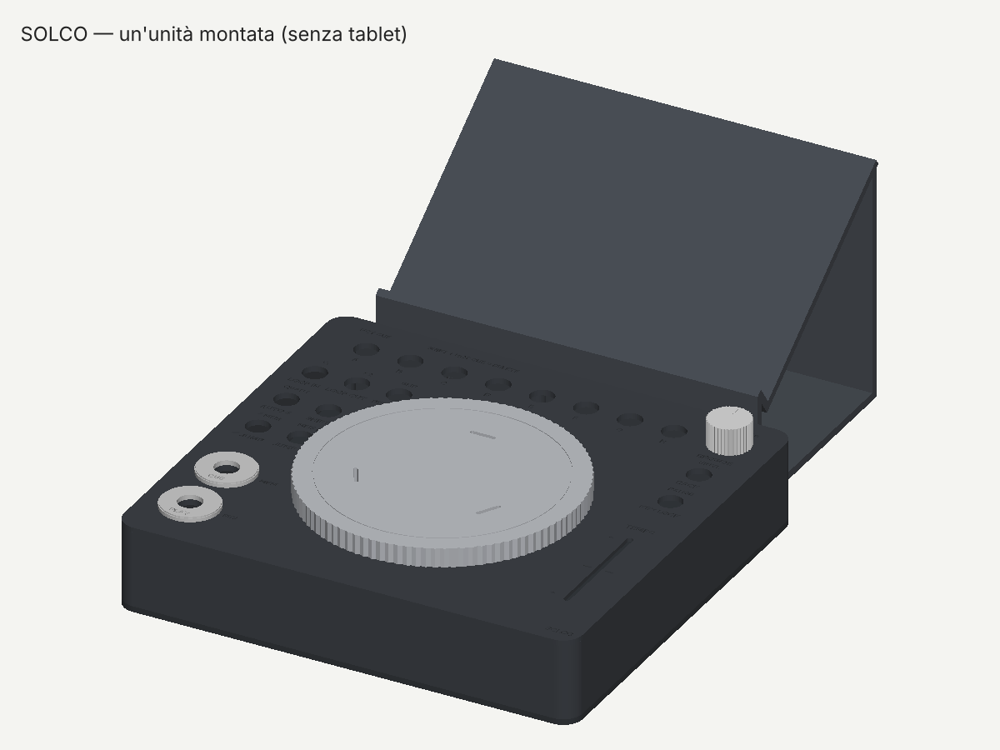
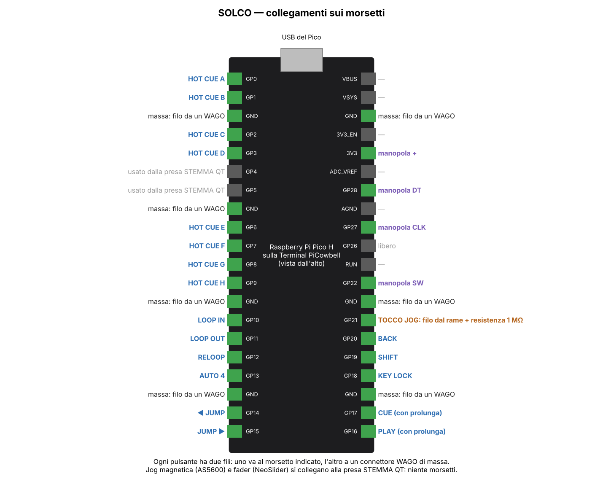
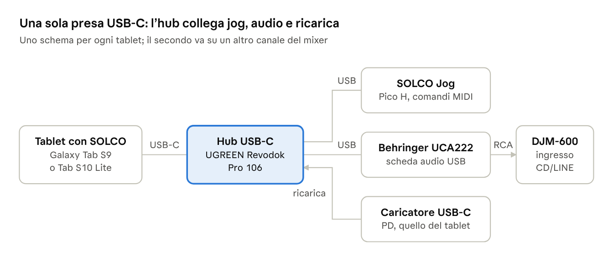

# SOLCO — comandi fisici e supporto per il tablet

Ogni tablet ha la sua unità: una scocca con jog, 19 pulsanti, manopola e fader tempo, più il supporto inclinato su cui appoggiare il tablet. Si costruiscono **due unità uguali**. Niente saldature: i fili si stringono in morsetti a vite o in connettori a leva.

## 1. Lista della spesa (per UNA unità: compra tutto due volte)

Prezzi controllati il 14/11/2026, spedizioni escluse: circa 149 € a unità per le voci con prezzo, più pulsanti e minuteria.

| Cosa | Per unità | Dove · prezzo |
|---|---|---|
| Raspberry Pi **Pico H** (RP2040, pin già saldati). **Non** il Pico 2: col chip RP2350 il tocco della jog non funziona | 1 | [Melopero](https://www.melopero.com/en/shop/raspberry-pi/boards/raspberry-pi-pico/) 6,10 € · [Opencircuit](https://opencircuit.shop/product/raspberry-pi-pico-h-pico-with-headers-soldered) 10,00 € |
| Adafruit **Terminal PiCowbell** con prese pre-saldate (5907) | 1 | [Opencircuit](https://opencircuit.shop/product/adafruit-terminal-picowbell-pico-pre-soldered) 20,00 € · [robot-domestici](https://website.robot-domestici.it/product/228578-adafruit-terminal-picowbell-for-pico-with-pre-soldered-sockets) 19,38 € + IVA |
| Adafruit **AS5600** sensore magnetico STEMMA QT (6357) | 1 | [Opencircuit](https://opencircuit.shop/product/adafruit-as5600-magnetic-angle-sensor) 11,25 € |
| Adafruit **NeoSlider** fader 75 mm STEMMA QT (5295) | 1 | [Opencircuit](https://opencircuit.shop/product/adafruit-neoslider-i2c-qt-slide-potentiometer) 16,75 € |
| Cavo **STEMMA QT 200 mm** (4401) | 2 | [Opencircuit](https://opencircuit.shop/product/stemma-qt-qwiic-jst-sh-4-pin-cable-200mm-long) 4,75 € l'uno |
| **Magnete diametrale** Ø6 × 2,5 mm (Radial Magnets 9042): deve essere *diametrale* | 1 (+1 scorta) | [DigiKey](https://www.digikey.it/en/products/detail/radial-magnets-inc/9042/5640338) 0,52 € |
| **Cuscinetto 6806-2RS** (30 × 42 × 7 mm) | 2 | [tymoty, marca EZO](https://www.tymoty.com/ezo-6806-2rs-deep-groove-ball-bearing) 12,90 € l'uno |
| **Encoder KY-040** (manopola con pulsante) | 1 | [AZ-Delivery](https://www.az-delivery.de/en/products/drehimpulsgeber-modul) 4,99 € |
| **Pulsanti 12 mm momentanei in metallo con 2 fili già collegati** (15 cm) | 19 | Amazon, confezioni da 5 o 10 |
| Cavetti Dupont maschio-maschio e femmina-maschio | 8 + 5 | kit misto |
| Resistenza da 1 MΩ | 1 | kit di resistenze |
| WAGO 221-415 (5 posti) e 221-412 (2 posti) | 5 + 2 | materiale elettrico |
| Nastro di rame con colla conduttiva, largo 50 mm | ~1 m | Amazon |
| Biadesivo sottile (sensore) e biadesivo forte tipo VHB (fader) | poco | ferramenta |
| Viti M3 × 12 e M3 × 20 a testa cilindrica | 13 + 2 | kit viti M3 |
| Piedini adesivi in gomma alti 3–5 mm | 8 | ferramenta |
| Fascetta da 15–20 cm e cavo USB-A → micro-USB da 30–50 cm | 1 + 1 | — |
| **Behringer UCA222**: scheda audio USB con uscite RCA | 1 | [Thomann](https://www.thomann.de/be/behringer_ucontrol_uca_222.htm) 19,90 € |
| **Hub USB-C** con ricarica PD e porte dati USB-A, es. UGREEN Revodok Pro 106 | 1 | [UGREEN](https://eu.ugreen.com/collections/product/products/45363) 29,99 € |
| Cavo RCA–RCA verso il DJM-600 e caricatore USB-C del tablet | 1 + 1 | — |

Da Opencircuit (Paesi Bassi) Pico H, PiCowbell, AS5600, NeoSlider e cavi arrivano con un solo ordine: 135 € per due unità. Il tablet ha una sola presa USB-C: l'hub ci collega insieme jog, scheda audio e caricatore.

## 2. Stampa (Bambu Lab P2S)

Nella cartella `stampa/` ci sono **4 piatti pronti** (`.3mf`) e i singoli pezzi (`.stl`). Ogni piatto va stampato **due volte** (una per tablet).

| Piatto | Contenuto | Note |
|---|---|---|
| `piatto_1_scocca.3mf` | pannello con pareti | si stampa capovolto: le scritte incise vengono sulla faccia liscia |
| `piatto_2_fondo.3mf` | fondo | |
| `piatto_3_jog_e_minuteria.3mf` | piatto della jog, rondella, supporto sensore, manopola, collari PLAY/CUE, morsetto del fader | jog con riempimento 40% (più pesante = più "vinile") |
| `piatto_4_supporto_tablet.3mf` | supporto del tablet | si stampa di fianco, alto 20 cm: aggiungi un brim di 5 mm |

Impostazioni: PLA (o PETG), strato 0,2 mm, 3 pareti, riempimento 15%, **nessun supporto**. Piatto testurizzato consigliato per la scocca.

Bambu Handy non sa preparare file nuovi: apri il `.3mf` con **Bambu Studio** sul Galaxy Book, premi *Slice* e poi *Print* (o *Invia*). Se chiede se caricare solo la geometria, rispondi sì. Le scritte incise sul pannello si possono ripassare con un pennarello a vernice bianco.

## 3. Montaggio

### Pannello
1. Infila i 19 pulsanti da sopra e stringi il dado da sotto. PLAY e CUE passano prima nel loro **collare** stampato.
2. Monta l'encoder KY-040 nel foro piccolo in alto a destra (dado sopra il pannello), con i piedini verso il centro. Spingi la manopola stampata sull'albero.

### Jog
1. **Rame sul pannello:** stendi il nastro di rame nell'anello tra i due solchi attorno al foro grande. Prima infila dal basso un cavetto Dupont maschio-maschio nel forellino a destra, piega il piedino sul pannello e coprilo col rame.
2. **Rame sul piatto:** sopra copri tutto il disco dentro il solco (strisce affiancate, taglia lungo il solco con un taglierino); sotto copri l'anello tra i due solchi. Fai passare una striscia larga 1 cm in ognuna delle 3 asole, attaccandola sopra e sotto: così il rame di sopra e quello di sotto sono collegati. Il bordo zigrinato resta senza rame (serve per spingere senza fare scratch).
3. Spingi i **due cuscinetti** nel foro grande dall'alto, uno sopra l'altro, fino in fondo.
4. Infila il **piatto** dall'alto finché il suo anellino appoggia sul cuscinetto.
5. Metti una goccia di colla nella sede della **rondella** e incastraci il magnete. Da sotto, appoggia la rondella all'albero e avvitala con **3 viti M3 × 12**: stringi finché il piatto non ha più gioco su e giù ma gira ancora libero.
6. **Sensore:** con il biadesivo sottile attacca l'AS5600 sul suo supporto, con il chip esattamente sull'incrocio inciso. Collega i due cavi STEMMA QT e avvita il supporto sotto il mozzo con **2 viti M3 × 20**.

### Fader
Infila la levetta del NeoSlider da sotto nella feritoia, centrala e incolla il corpo del cursore al pannello con il VHB. Per sicurezza aggiungi il morsetto stampato con **2 viti M3 × 12** (le asole permettono di centrarlo). Collega il secondo cavo STEMMA QT dall'AS5600 al NeoSlider. Se la manopolina del fader manca, ne va bene una per levette da 4 mm.

### Elettronica (sul fondo)
1. Innesta il Pico H sulla PiCowbell e appoggiala tra i fermi del fondo, con la presa USB verso destra; fissala con la fascetta.
2. Collega la presa STEMMA QT della PiCowbell al cavo che arriva dall'AS5600.
3. Ogni pulsante ha due fili: **uno** va al suo morsetto (vedi schema), **l'altro** in un WAGO 221-415. Riempi i WAGO a gruppi di 4 pulsanti e porta da ogni WAGO un cavetto maschio-maschio a un morsetto **GND**.
4. PLAY e CUE sono lontani: allunga il loro filo con un WAGO 221-412 e un cavetto maschio-maschio.
5. Manopola KY-040 con 5 cavetti femmina-maschio: CLK → GP27, DT → GP28, SW → GP22, + → 3V3, GND → GND.
6. Tocco della jog: resistenza da 1 MΩ tra il morsetto **GP21** e il **GND** accanto; nello stesso morsetto GP21 va il cavetto che arriva dal rame del pannello.
7. Cavo USB dal Pico fuori dalla tacca nella parete posteriore.

| Morsetto | Collegamento |
|---|---|
| GP0, GP1, GP2, GP3, GP6, GP7, GP8, GP9 | HOT CUE A–H |
| GP10 · GP11 · GP12 · GP13 | LOOP IN · LOOP OUT · RELOOP · AUTO 4 |
| GP14 · GP15 | ◀ JUMP · JUMP ▶ |
| GP16 · GP17 · GP18 · GP19 · GP20 | PLAY · CUE · KEY LOCK · SHIFT · BACK |
| GP21 | rame del pannello + resistenza 1 MΩ verso GND |
| GP22 · GP27 · GP28 · 3V3 | manopola SW · CLK · DT · + |
| GND | cavetti dai WAGO, GND della manopola |
| STEMMA QT | AS5600 → NeoSlider (a catena) |

### Chiusura e supporto
1. Attacca 4 piedini sotto il fondo e 4 sotto il supporto del tablet (stessa altezza, così i fori combaciano).
2. Accosta il supporto al retro della scocca e fissalo **da dentro** con **2 viti M3 × 12** attraverso le asole della parete posteriore.
3. Chiudi il fondo con **6 viti M3 × 12**.
4. Dentro il supporto c'è posto per hub e scheda audio.

## 4. Programma della scheda
Vedi `firmware/README.md`: si installa CircuitPython sul Pico e si copiano `boot.py` e `code.py`. Nessuna libreria aggiuntiva.

## 5. Collegare tutto

Tablet → hub USB-C. Nell'hub: cavo del Pico, Behringer UCA222, caricatore. Uscita RCA della UCA222 → ingresso CD/LINE di un canale del DJM-600 (selettore del canale su CD/LINE). Il secondo tablet va su un altro canale.

## 6. Comandi

| Tasto | Normale | Con SHIFT |
|---|---|---|
| PLAY | play / pausa | reverse |
| CUE | cue | memorizza cue |
| HOT CUE A–H | richiama / salva | cancella |
| LOOP IN · LOOP OUT | inizio · fine loop | loop ½ · ×2 |
| RELOOP · AUTO 4 | riattiva / esci · loop di 4 battiti | slip · quantize |
| ◀ JUMP · JUMP ▶ | salto di battiti | cue in memoria precedente · successivo |
| KEY LOCK | tonalità bloccata | range del tempo (±6/8/10/16/50%) |
| BACK | chiude il browser | jog vinile ↔ CDJ |
| Manopola: gira · premi | scorre i brani · carica | brano prec./succ. · tempo a 0% |
| Jog | sopra (rame): scratch · bordo: spinta | — |

Le scritte piccole **sopra** i tasti sono le funzioni con SHIFT. I led del fader diventano verdi quando il fader è al centro (tempo 0%).

## 7. Prima prova e problemi
- **App:** *Impostazioni → Comandi → Monitor MIDI* mostra ogni messaggio che arriva; in alto deve comparire "SOLCO Jog".
- **Led del Pico** (a fondo aperto): fisso = tutto ok; lampeggio lento = magnete troppo lontano/vicino o non diametrale; lampeggio veloce = sensore non collegato.
- **Jog al contrario:** tieni premuti SHIFT e ◀ JUMP mentre colleghi il cavo (il led lampeggia 3 volte). La scelta resta memorizzata.
- **Fader al contrario:** *Impostazioni → Lettore → Inverti il fader tempo fisico*.
- **Il tocco non risponde o resta attivo:** non toccare la jog mentre colleghi il cavo (la scheda misura il riposo all'avvio). Se non va proprio, usa la modalità CDJ: la jog spinge e frena senza scratch.
- All'avvio dell'app muovi un attimo il fader, così il tempo si allinea.

## File

| Cartella | Contenuto |
|---|---|
| `stampa/` | piatti `.3mf` pronti e pezzi `.stl` |
| `anteprime/` | immagini dei pezzi, sezioni come le vede lo slicer, schema dei collegamenti |
| `cad/` | il programma che genera i pezzi (`python3 cad/genera.py`): misure in `cad/parti.py` |
